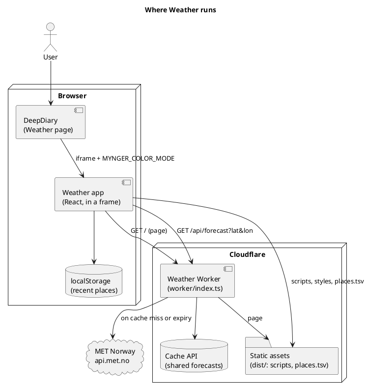
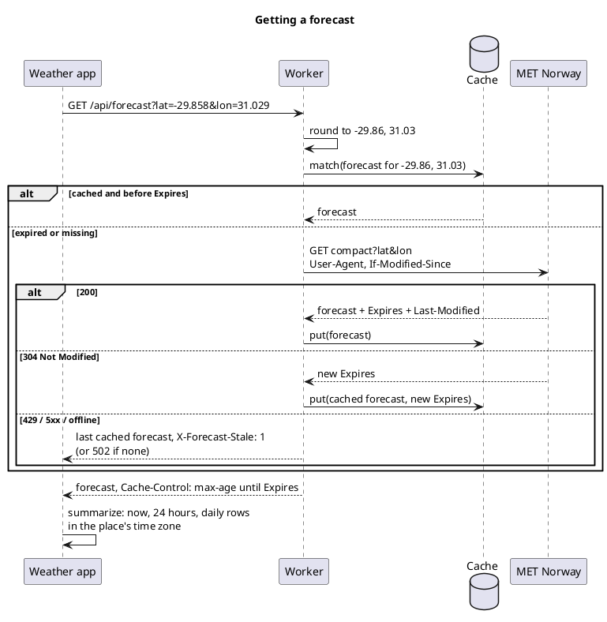

# Weather

A free worldwide weather forecast for planning ahead: the weather now, the next 24 hours hour by hour, and about
10 days ahead with highs, lows, rain and wind. It says when the next rain is due ("Rain likely from 15:00"), so
you can plan a run, a braai or a trip around it.

Weather runs on its own at its own address, and DeepDiary shows it on its Weather page in a frame, the same way
it shows Memories. It has no accounts, no database and no API keys.

## How it works

- **Forecasts** come from [MET Norway's Locationforecast](https://api.met.no/weatherapi/locationforecast/2.0/documentation)
  API. It's free for commercial use and covers every point on Earth. MET asks apps with real traffic not to call it
  from the browser, so a small [Cloudflare Worker](worker/index.ts) sits in front of it:
  - It rounds coordinates to 2 decimals (about 1 km). Everyone near the same spot shares one cached forecast, and
    exact positions never reach MET.
  - It keeps each forecast until MET's `Expires` time (usually about 30 minutes), then asks again with
    `If-Modified-Since`, as MET's terms require.
  - Requests for the same place that arrive together share one call to MET.
  - If MET is down or throttling, it serves the last forecast it had, marked stale, and the app says so.
  - It identifies the app to MET with `MET_USER_AGENT` in [wrangler.toml](wrangler.toml).
- **Place search** needs no API at all. [public/places.tsv](public/places.tsv) holds about 70,000 towns and cities
  with 5,000+ people, from [GeoNames](https://www.geonames.org) (`cities5000`). The browser downloads it once
  (about 1 MB compressed), the first time someone searches. "Use my location" asks the browser for the device's
  position and names it after the nearest town in that list.
- **Times** are shown in the place's own time zone, taken from the place list.
- **Recent places** (up to 6) are remembered in the browser's local storage. Nothing is sent anywhere else.
- **Light and dark** follow the device's setting. Inside DeepDiary they follow DeepDiary, which sends a
  `MYNGER_COLOR_MODE` message to the frame. DeepDiary sends Weather nothing else: no sign-in token, no user data.
- The same Worker serves the built app. Only the page itself and `/api/*` run Worker code. Scripts, styles and
  the place list are served as plain static files. The page gets a `frame-ancestors` header from
  `FRAME_ANCESTORS`, so only DeepDiary may show it in a frame.





## Code layout

| Folder | What's there |
|---|---|
| `src/app` | The app shell, the light/dark handling, styles |
| `src/forecast` | MET response types, turning the time series into hours and days, condition icons, the fetching hook |
| `src/places` | The place list and its search, the nearest-town lookup, recent places, "Use my location" |
| `src/ui` | The cards: now, the next 24 hours, the daily list, attribution |
| `worker` | The Cloudflare Worker: the forecast cache and the page headers |
| `cypress/e2e` | End-to-end tests against the running Worker and real MET forecasts |
| `docs` | The 2024 Solink tech-lead assessment this repo started as (its code is in git history on `master`) |

## Build, run and test

You need Node.js 20 or newer. You don't need a Cloudflare account to run Weather locally.

```bash
npm install
npm start          # builds the app, then runs the Worker at http://localhost:8787
```

`npm start` runs the production setup locally: the built app plus the real forecast cache, calling MET Norway.
It lets DeepDiary on `http://localhost:4000` show Weather in a frame. To work on the UI with hot reload, keep
`npm start` running and also run:

```bash
npm run dev        # http://localhost:5174, sends /api calls to the Worker on 8787
```

Tests and checks:

```bash
npm test           # unit tests (Jest): forecast summary, place search, cache rules, the app
npm run test:e2e   # starts the Worker and runs Cypress against it, with real MET forecasts
npm run lint
npm run typecheck
npm run build      # dist/
```

If the Worker is already running, `npx cypress run` runs the end-to-end tests on their own.

### Rebuilding the place list

`public/places.tsv` is built from GeoNames' `cities5000.txt`, from
[download.geonames.org/export/dump](https://download.geonames.org/export/dump/). The first line lists the time
zones. Each later line is `name`, `country code`, `lat`, `lon` and `time-zone index`, largest places first. To
refresh it, download and unzip `cities5000.zip`, then turn it into that format: sort by population (column 15),
keep name (column 2), country (9), lat (5), lon (6) and time zone (18), and round lat and lon to 2 decimals.

## Deploying

```bash
npx wrangler login   # once, with the Cloudflare account that will host Weather
npm run deploy       # builds and deploys the Worker and the app
```

Then give the Worker its address (planned: `https://weather.mynger.com`) as a custom domain in the Cloudflare
dashboard. DeepDiary's production build hides its Weather page until `REACT_APP_WEATHER_URL` is set to that
address in its build environment (Amplify), so DeepDiary can ship before Weather is live. In local development,
DeepDiary uses `http://localhost:8787`. To let more sites frame Weather, add them to `FRAME_ANCESTORS` in
`wrangler.toml`.

On Cloudflare's free plan, Workers run up to 100,000 requests a day. Static files don't count toward that, so in
practice it covers page loads and forecast requests. MET asks that total traffic stay under 20 requests a second.
Rounding and caching keep the calls to MET roughly proportional to how many distinct places people look at, not to
how many people use the app.

## Data and credits

- Forecast data: MET Norway, [CC BY 4.0](https://creativecommons.org/licenses/by/4.0/)
  ([terms](https://api.met.no/doc/TermsOfService))
- Place names: GeoNames, [CC BY 4.0](https://creativecommons.org/licenses/by/4.0/)

Both are credited at the foot of the app, as their licences require.
