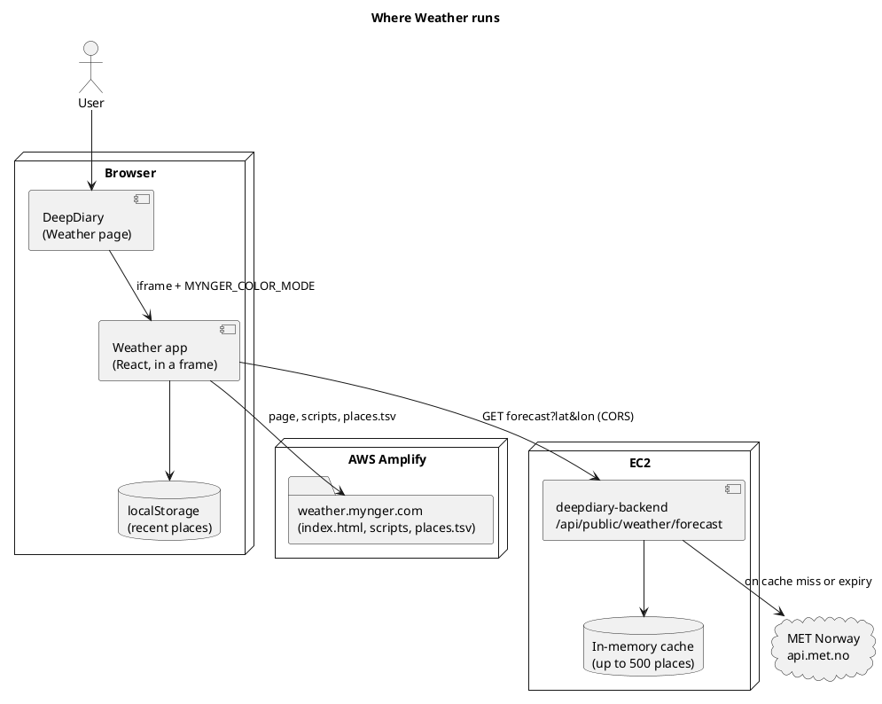
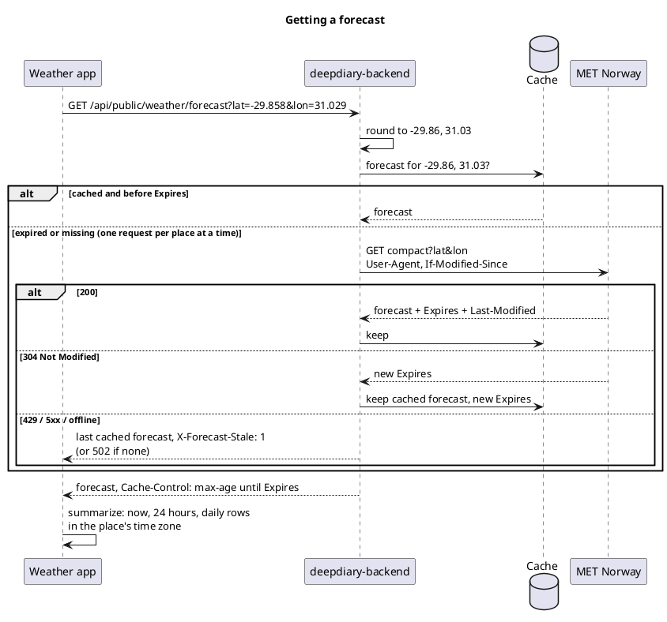

# Weather

A free worldwide weather forecast for planning ahead: the weather now, the next 24 hours hour by hour, and about
10 days ahead with highs, lows, rain and wind. It says when the next rain is due ("Rain likely from 15:00"), so
you can plan a run, a braai or a trip around it.

Weather is a static React app hosted on Amplify at `https://weather.mynger.com`, like Memories. DeepDiary shows it
on its Weather page in a frame. Weather has no accounts and stores nothing on a server.

## How it works

- **Forecasts** come from [MET Norway's Locationforecast](https://api.met.no/weatherapi/locationforecast/2.0/documentation)
  API. It's free for commercial use and covers every point on Earth. MET asks apps with real traffic not to call it
  from the browser, so the app asks **deepdiary-backend** instead, at `GET /api/public/weather/forecast?lat=&lon=`
  (open to everyone, no sign-in). The backend:
  - rounds coordinates to 2 decimals (about 1 km), so everyone near the same spot shares one cached forecast and
    exact positions never reach MET;
  - keeps each forecast in memory until MET's `Expires` time (usually about 30 minutes), then asks again with
    `If-Modified-Since`, as MET's terms require;
  - makes requests for the same place that arrive together share one call to MET;
  - serves the last forecast it had, marked with `X-Forecast-Stale: 1`, if MET is down or throttling, and the
    app says so;
  - keeps at most 500 places (a forecast is about 40 KB, and the backend runs in a 256 MB heap);
  - identifies itself to MET with `deepdiary.weather.user-agent`. The code is in deepdiary-backend's
    `service/weather` package and `PublicWeatherController`.
- **Place search** needs no API at all. [public/places.tsv](public/places.tsv) holds about 70,000 towns and cities
  with 5,000+ people, from [GeoNames](https://www.geonames.org) (`cities5000`). The browser downloads it once
  (about 1 MB compressed), the first time someone searches. "Use my location" asks the browser for the device's
  position and names it after the nearest town in that list.
- **Times** are shown in the place's own time zone, taken from the place list.
- **Recent places** (up to 6) are remembered in the browser's local storage.
- **Light and dark** follow the device's setting. Inside DeepDiary they follow DeepDiary, which sends a
  `MYNGER_COLOR_MODE` message to the frame. DeepDiary sends Weather nothing else: no sign-in token, no user data.
- [customHttp.yml](customHttp.yml) sets Amplify's headers. Its `frame-ancestors` rule means only DeepDiary may
  show Weather in a frame.





## Code layout

| Folder | What's there |
|---|---|
| `src/app` | The app shell, its settings (`config.ts`), the light/dark handling, styles |
| `src/forecast` | MET response types, turning the time series into hours and days, condition icons, the fetching hook |
| `src/places` | The place list and its search, the nearest-town lookup, recent places, "Use my location" |
| `src/ui` | The cards: now, the next 24 hours, the daily list, attribution |
| `cypress/e2e` | End-to-end tests against the dev server and a local deepdiary-backend, with real MET forecasts |
| `docs` | The 2024 Solink tech-lead assessment this repo started as (its code is in git history on `master`) |

## Build, run and test

You need Node.js 20 or newer, and deepdiary-backend running locally for forecasts. See its README; it listens on
`http://localhost:8080`.

```bash
npm install
npm run dev        # http://localhost:5174; /api goes to the backend on localhost:8080
```

To use a backend on another port, set `API_PROXY`, e.g. `API_PROXY=http://localhost:8082 npm run dev`. DeepDiary
running locally frames `http://localhost:5174` on its Weather page.

Tests and checks:

```bash
npm test           # unit tests (Jest): forecast summary, place search, settings, the app
npm run test:e2e   # starts the dev server and runs Cypress (needs the local backend)
npm run lint
npm run typecheck
npm run build      # dist/
```

If the dev server is already running, `npx cypress run` runs the end-to-end tests on their own.

The app calls `https://api.deepdiary.mynger.com/api` in production, `/api` under `npm run dev`, or whatever
`VITE_API_URL` is set to at build time.

### Rebuilding the place list

`public/places.tsv` is built from GeoNames' `cities5000.txt`, from
[download.geonames.org/export/dump](https://download.geonames.org/export/dump/). The first line lists the time
zones. Each later line is `name`, `country code`, `lat`, `lon` and `time-zone index`, largest places first. To
refresh it, download and unzip `cities5000.zip`, then turn it into that format: sort by population (column 15),
keep name (column 2), country (9), lat (5), lon (6) and time zone (18), and round lat and lon to 2 decimals.

## Hosting

- **App:** an Amplify app connected to this repo's `master` branch. Build command `npm run build`, output folder
  `dist`. Amplify picks up `customHttp.yml`.
- **Address:** a CNAME record for `weather` in Cloudflare's mynger.com DNS, pointing at the Amplify app's domain,
  like the other apps.
- **Forecasts:** deepdiary-backend on EC2, deployed as usual (pushes to its `main`). It allows
  `https://weather.mynger.com` in `cors.allowed-origins`.
- **DeepDiary:** its Weather page appears once its Amplify build has
  `REACT_APP_WEATHER_URL=https://weather.mynger.com`.

## Data and credits

- Forecast data: MET Norway, [CC BY 4.0](https://creativecommons.org/licenses/by/4.0/)
  ([terms](https://api.met.no/doc/TermsOfService))
- Place names: GeoNames, [CC BY 4.0](https://creativecommons.org/licenses/by/4.0/)

Both are credited at the foot of the app, as their licences require.
